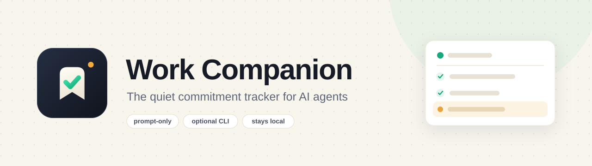

<p align="center">
  <picture>
    <source media="(prefers-color-scheme: dark)" srcset="assets/banner-dark.svg">
    
  </picture>
</p>

<p align="center">
  <a href="README.md" title="用简体中文阅读"></a>
  
</p>

<p align="center">
  <a href="CHANGELOG.md"></a>
  
  
  <br>
  <a href="LICENSE"></a>
  
  
</p>

> An Agent Skill for one thing: **make sure what you promised doesn't slip.**
> It records the commitments you say out loud, your own tasks, and the follow-ups you explicitly ask it to track; it lists them all when you ask, and adds a line when you call it a day.
> No nagging, no interrupting, no planning for you, no timers you didn't ask for.

It is **pure prompt**: one `SKILL.md` that works in any agent supporting the [Agent Skills specification](https://agentskills.io/specification). No server, no network, no data collection.

---

## What it solves

What you said last turn is gone by the next one. That isn't the model being forgetful — context simply rolls over.

Work Companion fills that gap: **it lifts "things I agreed to do" out of the conversation and puts them somewhere that outlives it**, then brings them back when needed.

- You say "I need to hand in a proposal on Friday" → it converts that to `2026-11-20`, writes it to the list, and tells you where the list is
- You say "I want to finish the report" → recorded as a task, with the due date left blank
- You say "remind me to chase him on Wednesday" → recorded as **to-nudge**; "he promised a quote on Friday, remind me then" → **waiting-on-them**
- You ask "what haven't I done yet?" → it lists everything in two sections: **yours to do** and **waiting on them**
- You say "that's it for now" → if something on the list is overdue or due within three days, it adds one line at the end of its reply — **just one**

Otherwise it stays quiet.

## What it deliberately does not do

Earlier versions did these. All were removed on 2026-11-12: the model has no reliable signal for "is this the moment to act?", so they only ever produced guesses or empty promises.

| Not done | Why |
|---|---|
| Scheduled reviews, weekly summaries | There is no observable signal for "it's time to review" |
| Analysing your work patterns, pointing out recurring blockers | Same, and easy to make up |
| Emotional reassurance, pressure to hurry | This is a reminder tool, not a coach |
| Scheduling timers without your request | Produces empty promises |
| Ranking your priorities | It sorts by due date and does not editorialise about what to do first |

## The four actions

- **Record on the spot** — you state a commitment, a task of your own, or explicitly ask it to track a follow-up. It says "I've noted it" **only if it actually wrote to the list in that turn**.
- **List everything when asked** — you say "what haven't I done yet?" It answers in two sections: **yours to do** (open + to-nudge) and **waiting on them** (waiting-on-them), each sorted by due date. Voided items are omitted; deleted ones are never mentioned again.
- **One line at wrap-up** — you use an explicit wrap-up phrase (`先这样` / `收工` / `就这样` / `今天到这` / `先到这` / `没别的了` — roughly "that's it for now" or "calling it a day"), and the list contains an item due today, overdue, or due within three days. At most one sentence, and **that sentence carries exactly one item**.
- **One-shot timer** — **only when you explicitly ask for one**. If you give a date but no time, it asks once for the exact time; if you don't answer, it records the item and does not schedule anything. If it cannot schedule, it says so.

Every record has five fields: **content (your wording) / recorded on / due on / status / reminder history**. Five statuses: **open / done / voided / waiting-on-them / to-nudge**.

Relative dates are converted to absolute dates on the spot; a genuinely ambiguous date gets exactly one clarifying question (asked once, never guessed).

> **Language note:** `SKILL.md` is written in Chinese, and the explicit wrap-up phrases above are Chinese-only. The model still replies in whatever language you write in; the English glosses are explanations, not extra trigger phrases. The development docs linked below are also Chinese-only for now.

## Install into your agent

It follows the [Agent Skills specification](https://agentskills.io/specification): one directory + one `SKILL.md` + an optional `scripts/`. Any agent that scans a skills directory can use the same files.

### Quickest: one command (recommended)

```bash
npx skills add EDboy-616/work-companion
```

Powered by [vercel-labs/skills](https://github.com/vercel-labs/skills), which detects the agents you have installed and lets you choose. Add `-g` for a global install (usable across projects); without it, it installs into the current project.

### This repository's install scripts

macOS / Linux / Git Bash:

```bash
git clone https://github.com/EDboy-616/work-companion.git && cd work-companion && ./install.sh
```

Windows PowerShell:

```powershell
git clone https://github.com/EDboy-616/work-companion.git; cd work-companion; .\install.ps1
```

Common flags:

```bash
./install.sh --target codex      # pick a harness
./install.sh --target all        # install into every harness present on this machine
./install.sh --dir ~/my/skills   # custom directory
./install.sh --force             # overwrite an existing copy
./install.sh --with-scripts      # also install the optional ledger script
```

You can also run it remotely without cloning (the repository is public):

```bash
curl -fsSL https://raw.githubusercontent.com/EDboy-616/work-companion/main/install.sh | sh
```

### Claude Code plugin marketplace

```
/plugin marketplace add EDboy-616/work-companion
/plugin install work-companion@work-companion-marketplace
```

### Manual copy

Copy the whole `skills/work-companion/` directory into your agent's skills directory. Global paths (`~` is your home directory):

**International**

| Agent | Global directory | Notes |
|---|---|---|
| Claude Code | `~/.claude/skills/` | Verified on this machine |
| Codex | `~/.codex/skills/` | Per official docs; newer versions also read `~/.agents/skills/` |
| Cursor | `~/.cursor/skills/` | Project-level uses `.agents/skills/` |
| Gemini CLI | `~/.gemini/skills/` | Project-level uses `.agents/skills/` |
| OpenCode | `~/.config/opencode/skills/` | |
| GitHub Copilot | `~/.copilot/skills/` | |
| Windsurf | `~/.codeium/windsurf/skills/` | |
| Amp / Replit | `~/.config/agents/skills/` | Shared directory |
| Kiro CLI | `~/.kiro/skills/` | |
| OpenClaw | `~/.openclaw/skills/` | |
| Roo Code / Cline | `~/.agents/skills/` | |
| Antigravity | `~/.gemini/config/skills/` | |

**China / regional**

| Agent | Global directory |
|---|---|
| Tongyi Lingma (通义灵码) | `~/.lingma/skills/` |
| Qoder | `~/.qoder/skills/` |
| Qoder CN | `~/.qoder-cn/skills/` |
| Tencent CodeBuddy | `~/.codebuddy/skills/` |
| Trae | `~/.trae/skills/` |
| Trae CN | `~/.trae-cn/skills/` |
| Qwen Code | `~/.qwen/skills/` |
| Kimi Code CLI | `~/.agents/skills/` |
| iFlow CLI | `~/.iflow/skills/` |
| MiniMax Code | `~/.minimax/skills/` |

> Paths come from each agent's documentation and the [vercel-labs/skills support list](https://github.com/vercel-labs/skills/blob/main/docs/agents.md) (80+ in total). Apart from Claude Code, this repository has **not tested each one** — if a path doesn't match, trust the agent's own Settings → Skills screen, and feel free to open an issue. A restart is usually unnecessary; the directory is picked up as soon as it appears.

## Where the list lives

One **fixed location unrelated to your current project**: relative to your home directory, always `work-companion/commitments.md` — no renaming, no relocation.

- **It never writes into your current working directory** — that's your project, and it shouldn't sprout extra files; the list would also disappear the moment you switch folders
- **Read first, never overwrite wholesale** — reschedule the original line, change the status, mark it voided, delete the whole line
- **One list across projects** — the same list is read no matter which repository you're working in
- **No sync across machines** — each machine keeps its own; this is a deliberate trade-off
- **The first time it writes in a session, it reports the full path in that reply** (once only)

`commitments.md` contains your personal work data and **never enters the repository** — it is excluded by `.gitignore`.

### Optional ledger CLI

`skills/work-companion/scripts/ledger.py` is a single-file, standard-library-only Python 3 tool. Installing it is optional; the skill works without it. When present, it handles the mechanical parts: `query` lists open items in two sections, `list` shows everything, `add` appends, `update` changes status/reschedules/deletes, `validate` checks fields and duplicates, `due --within 3` computes the wrap-up window, and `self-test` self-checks.

It writes with file locking and atomic replacement, so two concurrent sessions don't lose entries. Install it with `--with-scripts` (`-WithScripts` on PowerShell).

**Without it, the text rules still work in full.** If it can't see the script, it neither looks for it nor probes for it.

## Cross-harness compatibility

`SKILL.md` is deliberately platform-neutral, under five hard constraints:

1. Frontmatter contains **only** `name` + `description` (the minimal set the spec requires) — no `allowed-tools` / `model` etc.
2. `description` is bilingual and written as **layered routing copy**: what it does + when to use it + when not to
3. The body **names no tools** — no Read/Write/Bash, only "record / read / write a file"
4. Core behaviour **never depends on absolute paths, scripts, or environment variables**
5. **Fallback rule**: when the environment has neither a memory mechanism nor a writable file, it watches only for the rest of that conversation and says so plainly — and **it never says "I've noted it" without an actual write**

See [COMPATIBILITY.md](COMPATIBILITY.md) (Chinese).

## Privacy

- The list lives **on your own machine**; the skill uploads nothing, sends nothing, and uses no network
- It records only the **wording and dates** of commitments / tasks / follow-ups — no moods, no psychological analysis
- "Forget it" deletes the entry for good, with no backup
- The optional script reads and writes files locally only

## Is this really a skill?

**Yes — a standard Agent Skill.**

Agent Skills is a standard open-sourced by Anthropic in December 2025 (spec: [agentskills.io](https://agentskills.io/specification)); at its core it is "one directory + one `SKILL.md` with YAML frontmatter". This repository's `skills/work-companion/` complies fully: `name` matches the directory name, `description` is under 1024 characters, and the body depends on no single runtime.

If you tried it in a DeepSeek harness and saw it generate timer information on its own — that is by design: **it only schedules when you explicitly ask**, and when it does, it tells you when the timer will fire. If your run didn't ask for the exact time first, you were on a version before 0.4.1; from 0.4.1 on, a date without a time triggers one clarifying question.

## Contributing

- **Discussion / questions**: open a [Discussion](https://github.com/EDboy-616/work-companion/discussions)
- **Bugs / suggestions**: open an [Issue](https://github.com/EDboy-616/work-companion/issues) with your harness, version, and what it actually said
- **Code changes**: this repository has no build / lint / test commands — the thing under test is a prompt. The loop is **edit `SKILL.md` → install locally → run it by hand**; the scenario scripts are in [TESTING.md](TESTING.md). Read [CLAUDE.md](CLAUDE.md) first — it records the pitfalls this project has hit repeatedly. (Both are Chinese-only for now.)

## Repository layout

```
assets/                  # Brand assets: self-hosted SVG (logo / light-dark banners / badges)
skills/work-companion/
├─ SKILL.md              # ★ Core: single source of truth
├─ test-prompts.json     # Evaluation samples (not installed)
└─ scripts/ledger.py     # Optional ledger CLI
.claude-plugin/          # Plugin and marketplace manifests
install.sh / install.ps1 # One-line installers
README.md / README.en.md # Chinese / English
```

Development docs (kept in the repository so every rule's history is traceable):

| File | Contents |
|---|---|
| [CLAUDE.md](CLAUDE.md) | Development guide: architecture, five invariants, pitfalls |
| [TESTING.md](TESTING.md) | Test scripts A–W; scenarios instead of a test suite |
| [COMPATIBILITY.md](COMPATIBILITY.md) | Compatibility decisions and the environment support table |
| [TEST-RUN-*.md](.) | Real test runs and evaluation records |
| [CHANGELOG.md](CHANGELOG.md) | Release history |

## License

[MIT](LICENSE) © 2026 EDboy-616

Use it, modify it, redistribute it, use it commercially — just keep the copyright notice.

<p align="center"><sub><a href="README.md">简体中文</a> · English</sub></p>
