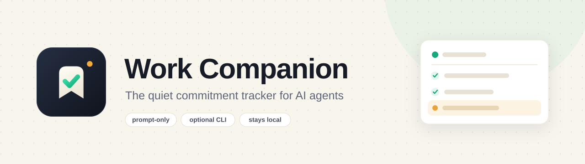

<p align="center">
  <picture>
    <source media="(prefers-color-scheme: dark)" srcset="assets/banner-dark.svg">
    
  </picture>
</p>

<p align="center">
  <a href="README.en.md" title="Read in English"></a>
  
</p>

<p align="center">
  <a href="CHANGELOG.md"></a>
  
  
  <br>
  <a href="LICENSE"></a>
  
  
</p>

> 一个 Agent Skill：**别让你答应过的事被忘掉。**
> 记下你亲口说的承诺、自己的任务，和你明确要求盯的跟进；你问起时列全，你说收工时顺带提一句。
> 不催、不打断、不替你规划、不擅自定时。

它是一段**纯提示词**——一份 `SKILL.md`，装进任何支持 [Agent Skills 规范](https://agentskills.io/specification) 的 agent 就能用。没有服务端、不联网、不收集任何数据。

---

## 它解决什么

你说过的话，agent 下一轮就忘。这不是模型笨，是上下文本来就会滚走。

Work Companion 补的就是这一块：**把"我答应过要办的事"从对话里摘出来，落到一个对话之外的地方**，需要时再拿回来。

- 你说"周五要交个方案" → 它换算成 `2026-11-20` 记进清单，并告诉你清单在哪
- 你说"我要把报告写完" → 记成任务，到期日留空
- 你说"提醒我周三催他" → 记成**待跟进**；说"他答应周五给报价，到时提醒我" → 记成**等待对方**
- 你问"我有什么没做的" → 分「你要做的」「等对方」两段列全
- 你说"先这样" → 如果清单里有一件事逾期或三天内到期，在回复末尾顺带提一句，**只说一条**

除此之外它不开口。

## 它刻意不做什么

这几件事以前的版本写过，2026-11-12 全删了——因为模型没有可靠信号判断"现在该不该做"，写出来只会变成瞎猜或空许诺：

| 不做 | 原因 |
|---|---|
| 定时主动回顾、周报式小结 | 没有"该回顾了"这个可观察信号 |
| 分析你的工作模式、指出反复阻塞 | 同上，且容易编 |
| 情绪安抚、催促施压 | 这是提醒工具，不是教练 |
| 未经你要求就挂定时任务 | 只会产生空许诺 |
| 替你排优先级 | 按到期日排，不点评"该先做哪个" |

## 四个动作

- **当场记下**——你亲口说出承诺、自己的任务，或明确要求盯着某个跟进时。**只有这一轮真的写进清单了**，它才说"我记下了"。
- **被问就列全**——你说"我有什么没做的"。分「你要做的」（未完成＋待跟进）、「等对方」（等待对方），段内按到期日；作废的不列，删掉的连提都不提。
- **收尾顺带一句**——你说出明确收尾词（`先这样`／`收工`／`就这样`／`今天到这`／`先到这`／`没别的了`）且清单里有逾期／今天／三天内到期的条目。一次最多一句，**一句只装一条**。
- **定时唤起**——**仅在你明确要求时**。只说了哪天没说几点，它会先问一次具体时刻；问了不答就先记下、不挂。挂不上就直说。

每条记录五个字段：**内容（原话）／记录日／到期日／状态／提醒历史**。状态五种：**未完成／已完成／已作废／等待对方／待跟进**。

相对日期当场换算成绝对日期；有歧义当场反问一次（只问一次，不猜）。

## 装到你的 agent 里

它遵循 [Agent Skills 规范](https://agentskills.io/specification)：一个目录 + 一个 `SKILL.md` + 可选 `scripts/`。所以任何扫描 skills 目录的 agent 都能用同一份文件。

### 最省事：一条命令（推荐）

```bash
npx skills add EDboy-616/work-companion
```

由 [vercel-labs/skills](https://github.com/vercel-labs/skills) 提供，自动检测你装了哪些 agent 并让你选。加 `-g` 装到全局（跨项目可用），不加则装进当前项目。

### 本仓库的安装脚本

macOS / Linux / Git Bash：

```bash
git clone https://github.com/EDboy-616/work-companion.git && cd work-companion && ./install.sh
```

Windows PowerShell：

```powershell
git clone https://github.com/EDboy-616/work-companion.git; cd work-companion; .\install.ps1
```

常用参数：

```bash
./install.sh --target codex      # 指定 harness
./install.sh --target all        # 装到本机已存在的 harness
./install.sh --dir ~/my/skills   # 自定义目录
./install.sh --force             # 覆盖已存在的版本
./install.sh --with-scripts      # 连同可选的清单脚本一起装
```

也可以不 clone，直接远程跑（仓库已公开）：

```bash
curl -fsSL https://raw.githubusercontent.com/EDboy-616/work-companion/main/install.sh | sh
```

### Claude Code 插件市场

```
/plugin marketplace add EDboy-616/work-companion
/plugin install work-companion@work-companion-marketplace
```

### 手动复制

把 `skills/work-companion/` 整个目录复制到目标 agent 的 skills 目录。全局路径（`~` 为你的主目录）：

**国际**

| Agent | 全局目录 | 备注 |
|---|---|---|
| Claude Code | `~/.claude/skills/` | 本机已实测 |
| Codex | `~/.codex/skills/` | 官方文档口径；新版本也认 `~/.agents/skills/` |
| Cursor | `~/.cursor/skills/` | 项目级用 `.agents/skills/` |
| Gemini CLI | `~/.gemini/skills/` | 项目级用 `.agents/skills/` |
| OpenCode | `~/.config/opencode/skills/` | |
| GitHub Copilot | `~/.copilot/skills/` | |
| Windsurf | `~/.codeium/windsurf/skills/` | |
| Amp / Replit | `~/.config/agents/skills/` | 通用目录 |
| Kiro CLI | `~/.kiro/skills/` | |
| OpenClaw | `~/.openclaw/skills/` | |
| Roo Code / Cline | `~/.agents/skills/` | |
| Antigravity | `~/.gemini/config/skills/` | |

**国内**

| Agent | 全局目录 |
|---|---|
| 通义灵码 / Lingma | `~/.lingma/skills/` |
| Qoder | `~/.qoder/skills/` |
| Qoder CN | `~/.qoder-cn/skills/` |
| 腾讯 CodeBuddy | `~/.codebuddy/skills/` |
| Trae | `~/.trae/skills/` |
| Trae CN | `~/.trae-cn/skills/` |
| Qwen Code | `~/.qwen/skills/` |
| Kimi Code CLI | `~/.agents/skills/` |
| iFlow CLI | `~/.iflow/skills/` |
| MiniMax Code | `~/.minimax/skills/` |

> 路径来自各 agent 文档与 [vercel-labs/skills 的支持列表](https://github.com/vercel-labs/skills/blob/main/docs/agents.md)（共 80+ 个）。除 Claude Code 外，本仓库**未逐个实测**——若与实际不符，以该 agent 的「设置 → 技能」界面为准，也欢迎开 issue 告诉我。装好后通常不用重启；目录一出现就被接管。

## 清单存在哪

一个**与你当前项目无关的固定位置**：相对你的主目录固定为 `work-companion/commitments.md`，不改名、不换位置。

- **不会写进你当前的工作目录**——那是你的项目，不该凭空多出文件；而且换个目录清单就断了
- **先读再写，绝不整份覆盖**——改期改原行、完成改状态、作废打标记、删除整行
- **跨项目共用一份**，在哪个仓库里干活读到的都是同一份
- **跨电脑不同步**：两台机器各写各的，这是明确取舍
- **本会话第一次写入的那一轮，它会把完整路径报给你**（只说一次）

`commitments.md` 含你的个人工作数据，**永远不进仓库**——`.gitignore` 已排除。

### 可选清单脚本

`skills/work-companion/scripts/ledger.py` 是个纯标准库的 Python 3 小工具，装不装都不影响 skill 工作。装上后可以做机械活：`query` 分两段列未结项、`list` 列全部、`add` 追加、`update` 改状态/改期/删除、`validate` 查字段与重复、`due --within 3` 算收尾窗口、`self-test` 自测。

用文件锁 + 原子替换写入，两个会话同时写不会丢条目。加 `--with-scripts`（PowerShell 用 `-WithScripts`）安装。

**没有它，文本规则照样完整工作。** 看不到脚本就不找、不探测。

## 跨 harness 兼容

`SKILL.md` 刻意做成平台中立，五条硬约束：

1. frontmatter **只有** `name` + `description`（规范要求的最小集），不加 `allowed-tools` / `model` 等
2. `description` 中英双语，写成**分层路由文案**：做什么 + 什么时候用 + 什么时候别用
3. 正文**零工具名**——不出现 Read/Write/Bash，只说"记录/读取/写入文件"
4. 核心行为**不依赖绝对路径、脚本、环境变量**
5. **降级规则**：环境既没有记忆机制、也没有可写文件时，只在这一次对话里盯着，并明说"只能在这次对话里帮你盯着"；**没写入就不说"我记下了"**

详见 [COMPATIBILITY.md](COMPATIBILITY.md)。

## 隐私

- 清单写在**你自己的机器上**，skill 不上传、不外发、不联网
- 只记承诺/任务/跟进的**原话与日期**，不记情绪、不做心理分析
- 说"忘了吧"即整条删除，不留备份、永不复现
- 可选脚本只在本地读写文件

## 这算不算 skill？

**算，而且是标准意义上的 Agent Skill。**

Agent Skills 是 Anthropic 于 2025-12 开源的标准（规范见 [agentskills.io](https://agentskills.io/specification)），核心就是「一个目录 + 一个带 YAML frontmatter 的 `SKILL.md`」。本仓库的 `skills/work-companion/` 完全符合：`name` 与目录名一致、`description` 在 1024 字符内、正文不依赖任何单一 runtime。

你在 DeepSeek 的 harness 里试出它自动生成了定时信息——这符合设计：**只有你明确要求定时时它才挂**，挂上就告诉你何时会响。如果你试的那次没让它先问具体几点，说明装的是 0.4.1 之前的版本；0.4.1 起，只说日期不说时刻它会先反问一次。

## 参与

- **讨论 / 提问**：开 [Discussion](https://github.com/EDboy-616/work-companion/discussions)
- **报 bug / 提建议**：开 [Issue](https://github.com/EDboy-616/work-companion/issues)，说清你的 harness、版本号、以及它实际说了什么
- **改代码**：这个仓库没有 build / lint / test 命令——"被测对象"是一段提示词。开发循环是**改 `SKILL.md` → 装到本地 → 手动试跑**，场景剧本在 [TESTING.md](TESTING.md)。改之前请先读 [CLAUDE.md](CLAUDE.md)，那里面记着这个项目反复踩过的坑。

## 仓库结构

```
assets/                  # 品牌资产：自托管 SVG（logo / 明暗横幅 / 徽章）
skills/work-companion/
├─ SKILL.md              # ★ 核心：唯一真相源
├─ test-prompts.json     # 评测样例（不会被安装）
└─ scripts/ledger.py     # 可选清单 CLI
.claude-plugin/          # 插件与 marketplace 清单
install.sh / install.ps1 # 一键安装脚本
README.md / README.en.md # 中文 / English
```

研发文档（保留在仓库里，方便追溯每一条规则是怎么来的）：

| 文件 | 内容 |
|---|---|
| [CLAUDE.md](CLAUDE.md) | 开发指引：架构要点、五条不变量、踩过的坑 |
| [TESTING.md](TESTING.md) | 试跑剧本 A–W，用场景代替测试 |
| [COMPATIBILITY.md](COMPATIBILITY.md) | 兼容性设计决策与环境适配表 |
| [TEST-RUN-*.md](.) | 历次真实试跑与评估记录 |
| [CHANGELOG.md](CHANGELOG.md) | 版本变更 |

## License

[MIT](LICENSE) © 2026 EDboy-616

随意使用、修改、分发、商用，保留版权声明即可。

<p align="center"><sub><a href="README.en.md">English</a> · 简体中文</sub></p>
